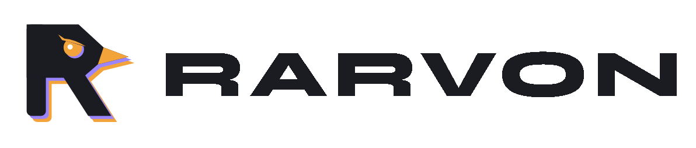

<p align="center">
  <picture>
    <source media="(prefers-color-scheme: dark)" srcset="design/brand/rarvon-final/png/rarvon-logo-for-dark@2x.png">
    
  </picture>
</p>

<h3 align="center">Free tools for your files. No ads. No account. Nothing uploaded.</h3>

<p align="center">
  PDFs, images, video, audio and text — 50+ tools that run entirely on your own device.<br>
  In English and Arabic, in your browser or as a desktop app.
</p>

<p align="center">
  <a href="#-what-you-can-do">Tools</a> ·
  <a href="#-private-by-design">Privacy</a> ·
  <a href="#-rarvon-for-desktop">Desktop app</a> ·
  <a href="#-run-it-yourself">Run it</a> ·
  <a href="#-support-rarvon">Support</a>
</p>

---

## ✦ Why Rarvon

Most "free" file websites upload your documents to someone else's server, show you ads, or stop you
halfway with a sign-up wall. Rarvon is the opposite:

| Promise | What it means |
|---|---|
| **Free, for good** | No subscriptions, no paywalls, nothing locked behind a plan. |
| **No ads, no tracking** | No banners, no pop-ups, no analytics, no cookies. |
| **No account** | Open a tool and use it. That's it. |
| **Your files stay yours** | Every tool runs on your device. Files are never uploaded — not even to Rarvon. |
| **Works offline** | After your first visit, the tools keep working without internet. |
| **English and العربية** | A full Arabic interface, right to left, with Arabic text support in the tools that need it. |
| **Light and dark** | Follows your system, or pick one. |

## ✦ What you can do

| | Tools |
|---|---|
| **PDF** | Edit (text in any language, drawing, highlights, shapes, images, comments, signature, redaction) · Merge · Split · Compress · PDF to Text (with OCR for scans) · Rotate · Extract, delete and reorder pages · PDF to Images · Images to PDF · Page numbers · Watermark · Sign · Metadata |
| **Image** | Background Remover (AI) · Image to Text (OCR, Arabic + English) · Convert (JPG, PNG, WebP, AVIF, GIF, TIFF, BMP, ICO, PSD and more) · Compress · Resize · Crop · Rotate · View and remove metadata |
| **Video** | Video Editor (timeline, text, music, export) · Convert (MP4, MOV, WebM, MKV, GIF) · Compress · Trim · Change resolution |
| **Audio** | Convert (MP3, AAC, Opus, WAV) · Compress · Trim · Extract audio from video |
| **Text** | Word counter · Case converter · Text cleaner · Remove duplicate lines · Line sorter |
| **Developer** | JSON formatter and minifier · Base64 · URL encoder · UUID · Hash · Timestamp · Color · JWT decoder · Regex tester |
| **Utilities** | File Compressor (ZIP) · ZIP Extractor · QR codes · Passwords · Random numbers |

**Drop any file on the home page** and Rarvon suggests what you can do with it. A tool's result can go
straight into the next tool, with no re-uploading.

## ✦ Private by design

- **Nothing leaves your device.** Rarvon has no server that receives files. Conversions, compression, OCR and
  AI all run locally in your browser or in the desktop app.
- **No cookies, no analytics, no fingerprinting.** Rarvon doesn't know who you are and doesn't try to find out.
- **No third-party requests.** Fonts, AI models and language data are served by Rarvon itself; nothing calls
  Google, ad networks or trackers.
- **Open to inspection.** The code is public, so anyone can check these promises.

Read the full [Privacy policy](PRIVACY.md).

## ✦ Rarvon for desktop

The same Rarvon, on your computer, with more power:

- **Any file size.** Video and audio run in FFmpeg on your own hardware, using your graphics card when it can.
- **Almost every format,** including AVI, WMV, FLV, MPEG and others that browsers can't open.
- **Its own window,** with no tabs or address bar. It closes itself when you close it.
- **Light:** about 7 MB of memory for the engine.

Windows 10 and 11 today (beta); Linux is planned. Downloads will be on the website once it launches.

## ✦ Run it yourself

You need [Node.js](https://nodejs.org) 22 or newer.

```bash
npm ci
```

```bash
npm run dev
```

Then open **http://localhost:5173**.

Step-by-step instructions, tests, the desktop app and publishing settings are in **[RUNNING.md](RUNNING.md)**.
Technical notes for development are in **[docs/DEVELOPMENT.md](docs/DEVELOPMENT.md)**.

## ✦ Found a bug? Want a tool?

Open an [issue](../../issues) and describe what happened or what you'd like to do.
Rarvon is maintained by one person, so pull requests aren't accepted — but every report is read.
For security problems, see [SECURITY.md](SECURITY.md).

## ✦ Support Rarvon

Rarvon is free and has no ads, and it will stay that way. If it saves you time, you can help keep it going
with a small donation — it never unlocks anything, it just says thank you. The Support page on the website
has the link.

## ✦ Thank you

Rarvon stands on the shoulders of excellent open-source work, including **pdf.js**, **pdf-lib**,
**Tesseract**, **Transformers.js**, **ONNX Runtime**, **Mediabunny**, **FFmpeg**, **React** and many more.
Every library, font and AI model is credited with its license in
[THIRD_PARTY_LICENSES.md](THIRD_PARTY_LICENSES.md) and on the website's *Credits and licenses* page.

## ✦ License and brand

**Rarvon is free to use, but it is not open source.** Copyright © 2026 ROBEE. All rights reserved.
The code is public so you can see how Rarvon works, check its privacy promises, and report bugs. It may not be
copied, modified, republished or used in another product without written permission. See [LICENSE](LICENSE).

**The Rarvon™ name and the raven logo are the property of ROBEE.** They are not covered by any license, and no
permission to use them is given. Please don't use the name or the logo (or anything confusingly similar) for
your own product, website, app or service, and don't present your work as connected to Rarvon. If you'd like
to mention Rarvon — in an article, a review, or a list of tools — you're welcome to use its name and link to it.

Third-party components keep their own licenses, listed in [THIRD_PARTY_LICENSES.md](THIRD_PARTY_LICENSES.md).

<p align="center"><br>Made with care by <a href="https://github.com/ROBEE404">ROBEE</a>.</p>
